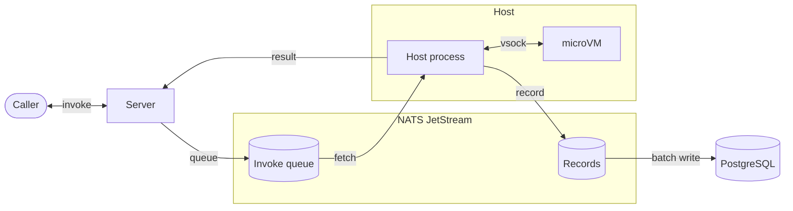

Alchemy has three processes. The **server** (`cmd/server`) serves the API, the
plain HTTP invoke endpoint and the web UI. The **host** (`cmd/host`) owns one
KVM machine and runs microVMs. The **supervisor** (`cmd/supervisor`) is the init
process inside every microVM. NATS JetStream carries everything between servers
and hosts. PostgreSQL stores functions, versions and finished invocations.

## Follow one invocation

1. **The server accepts the call.** It resolves the function and the version to
   run, reading both from PostgreSQL, and uses the version's compiled contract
   and artifact it keeps in memory. It checks the input against the size limit
   and holds the invocation in memory as `PENDING`. A call with an idempotency
   key claims the key in PostgreSQL first, which is the only write on the path.
2. **It queues the invocation.** The server publishes it to the `INVOKE` stream
   on `invoke.<tenant>.<function>`, with the invocation id as the message id so
   a retried publish is dropped as a duplicate. An input over 8 MiB goes to the
   `INVOKE_PAYLOADS` object store and the message names it. A sync call then
   waits on the server's own `server.<name>.result` subject.
3. **A host takes it.** Every host runs one puller per slot, and every puller
   fetches from the same durable consumer, so the first host with room takes the
   next invocation. A busy fleet makes calls wait in the queue rather than fail.
   The host reads the function's current settings from the `INVOKE_LEASES`
   key-value bucket and tells the stream every 10 seconds that it still holds
   the invocation. One held for 30 seconds without that goes to another host.
4. **It builds on first use.** A host that has never run this artifact builds it
   from the build request the message carries: it pulls the image at its pinned
   digest, writes the root filesystem and the layer drive, boots the microVM
   once and snapshots it. Other invocations of the artifact wait for that one
   build. See [Runtimes and builds](/pages/concepts/runtimes-and-builds).
5. **It takes a seat.** For a function with a `max_concurrency`, the host takes
   one of its seats in `INVOKE_LEASES`. With every seat held, the invocation goes
   back to the queue for a moment.
6. **It checks the input.** The host checks the input against the contract. An
   input that breaks it ends the invocation as `REJECTED` before any microVM is
   acquired. See [Contracts](/pages/concepts/contracts).
7. **It acquires an instance.** The host reuses a warm instance of the artifact
   when it has one. Otherwise it restores the artifact's snapshot into a new
   jailed microVM, or boots one when there is no snapshot.
8. **The supervisor runs the function.** The supervisor is PID 1 in the guest and
   listens on vsock port 1024. The host sends it the input, the timeout and the
   secret values. It starts the entrypoint, writes the input to its stdin,
   streams its stderr back as it is written and returns its stdout as the output.
9. **The host checks the output** against the contract and the size limit, and
   publishes the result to the waiting server. An output over 8 MiB rides in the
   object store. The server answers the caller.
10. **The record is written.** The host publishes the invocation's record to the
    `INVOCATIONS` stream, batching records for up to 100 ms. The servers share
    one durable consumer on that stream and write records to PostgreSQL in
    batches.

While it runs, the host publishes `STARTING` and `RUNNING` to the waiting
server, and the server publishes each change on `invocation.<function>` for
`TailInvocations` and the web UI. An async invocation has no waiting server, so
the host publishes those changes itself.

## Stateless servers

Nothing about an invocation is written while it runs. The server that accepted
it holds it in memory until it ends, and its record reaches the database
afterwards through the bus. The `INVOCATIONS` stream lives on disk and keeps
records for 24 hours by default, so a database outage delays records rather than
losing them.

Any number of servers run side by side. Each keeps its own view of the hosts
from their heartbeats, sent every 2 seconds, and lists a host for 10 seconds
after the last one. Builds are claimed in PostgreSQL, and a build whose server
died is taken over by another server once it is a minute past the build
timeout.

A host holds nothing durable beyond records it has not published yet. If it
dies, its microVMs die with it, and the invocations it held go back to the queue
once their ack wait runs out.

## Where the pieces live

| Package | Role |
|---|---|
| `internal/server` | The API, invoke over HTTP, builds, idempotency keys, the record writer |
| `internal/bus` | NATS subjects, the invoke queue, leases, the record and log streams |
| `internal/host` | Pulling, building, the warm pool, contract checks, secrets, records |
| `internal/driver/firecracker` | Root filesystems, layer drives, snapshots, the jailer |
| `internal/supervisor` | Running one invocation in the guest |
| `internal/contract` | Compiling and enforcing JSON Schema and Arrow contracts |
| `internal/artifact` | Naming artifacts, the same way on servers and hosts |
| `internal/logs` | The log bucket layout, uploads and reads |
