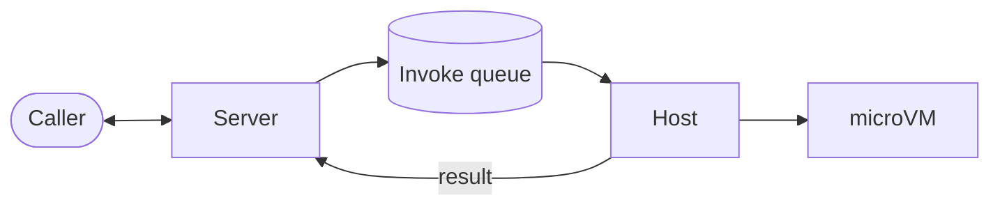

An Alchemy deployment is two binaries, the server and the host, connected through NATS JetStream, with PostgreSQL behind the server and object storage for logs and build layers. Kubernetes with the [Helm chart](/pages/deployment/kubernetes) is the recommended way to run it. Hosts need `/dev/kvm`, so they run on bare-metal nodes or on VMs with nested virtualization. The server runs anywhere.

## Components

| Component | What it does | Needs |
|---|---|---|
| Server | Serves the API, `POST /functions/<id>/invoke` and the web UI on one port (8780). Validates contracts, stores functions and versions, queues every invocation and waits for its result | PostgreSQL, NATS, the buckets. No KVM |
| Host | Takes invocations from the queue whenever it has a free slot. Builds each function's root filesystem, boots Firecracker microVMs and runs them | `/dev/kvm`, a privileged container, cgroup v2, NATS, the buckets. No PostgreSQL |
| PostgreSQL | Functions, versions, tenants, users, finished invocation records, idempotency keys and, by default, encrypted tenant secrets | |
| NATS JetStream | The invoke queue, results, host heartbeats, invocation records not yet written, and recent function logs | `max_payload` above 8 MiB, JetStream with file and memory storage |
| Function logs bucket | One gzipped log per invocation, and the outputs kept for idempotent replays | S3 or GCS, optional |
| Artifacts bucket | The layers builds extract over an image, such as a function's source files | S3 or GCS, optional |
| Registry | Function images and the runtime images, pulled by hosts | Any OCI registry |

The host image carries Firecracker, its jailer, a guest kernel and the in-VM supervisor, which the host copies into every function's root filesystem as init. There is no container daemon. Hosts pull images straight from their registries. ECR, Artifact Registry and GCR authenticate with the cloud's workload identity, and other registries use the Docker config or are pulled anonymously.

## How a call moves

The server that accepts a call holds it in memory and waits for its result. Hosts publish each invocation's record to a JetStream stream when it ends, and the servers write records to PostgreSQL in batches, so nothing is written to the database while an invocation runs. A call only reads its function and version. A busy fleet makes calls wait in the queue rather than fail. See [Architecture](/pages/concepts/architecture).

## What scales how

| Component | Scales by | Notes |
|---|---|---|
| Server | Replicas, by hand or with a CPU HorizontalPodAutoscaler | Any replica serves any request. A server holds only the sync calls it is waiting on. Each applies migrations on start, one at a time under a PostgreSQL lock |
| Host | One per KVM node, by hand or with KEDA on queue demand | Capacity is `MAX_INSTANCES` slots per host and an optional guest memory budget. See [Autoscaling](/pages/deployment/autoscaling) |
| PostgreSQL | Vertically | Read once per call for the function and version. Writes are batched records and keyed-call claims |
| NATS | `INVOKE_QUEUE_REPLICAS` and `INVOCATION_STREAM_REPLICAS` for stream replication | Replication above 1 needs a NATS cluster with at least that many servers |

A host holds nothing durable. Its data volume caches the kernel, built root filesystems and microVM jails, and losing it only means rebuilding on the next invocation.

## One tenant per cluster

Run one deployment per tenant: its own servers, hosts, NATS and PostgreSQL. Nothing is shared between deployments, so a tenant's queue, hosts and data are its own.

Inside a deployment, the server still scopes functions, invocations and secrets to the caller's tenant. With authentication off, every request runs in a built-in default tenant. With the `proxy` provider, `AUTH_PROXY_TENANT` pins the one tenant a deployment serves and refuses any other. See [Authentication](/pages/deployment/authentication).

## Next steps

<CardGroup cols={2}>
  <Card title="Kubernetes" icon="dharmachakra" href="/pages/deployment/kubernetes">
    Install the Helm chart.
  </Card>
  <Card title="KVM nodes" icon="microchip" href="/pages/deployment/kvm-nodes">
    Prepare the nodes hosts run on.
  </Card>
  <Card title="Storage" icon="database" href="/pages/deployment/storage">
    PostgreSQL, NATS and the buckets.
  </Card>
  <Card title="Configuration" icon="sliders" href="/pages/deployment/configuration">
    Every environment variable.
  </Card>
</CardGroup>
